# FMANet: Colorectal Tissue Classification from Histopathological Images

[](https://github.com/RashiChauhan67/FMANet/actions/workflows/ci.yml)
[](LICENSE)


> **Paper.** R. Chauhan, K. Mohan, P. Singh. *Fused multi-level attention features with a constraint fusion network for colorectal tissue classification using histopathological images.* **Computers and Electrical Engineering**, vol. 124, article 110296, 2025. DOI: [10.1016/j.compeleceng.2025.110296](https://doi.org/10.1016/j.compeleceng.2025.110296)

This repository holds the code behind that paper: a CNN that classifies colorectal histology tiles into tissue types. It fuses a **low-level** and a **high-level** feature stream with **constraint fusion**, which weights each stream by its cosine similarity to the combined features.

The code was cleaned up from the original Colab notebooks (kept unmodified in [`notebooks/`](notebooks/)). Please read [Relationship between this code and the paper](#relationship-between-this-code-and-the-paper) before comparing numbers: the notebooks and the paper differ in a few details, and they are listed there.

## Highlights

- Two datasets: Kather 5,000-tile histology (8 classes) and CRC-VAL-HE-7K (9 classes).
- Recorded test accuracy in the notebooks: **95.0%** (Kather, 500 test tiles) and **97.35%** (CRC-VAL-HE-7K, 718 test tiles).
- 5.39 M parameters, 20.6 MB (model size printed by the notebooks).
- Modular Keras 3 port with unit tests, a command-line trainer, and two training protocols (`notebook` and a leakage-free `holdout`).

## Architecture

The author's figure from the paper (full network):

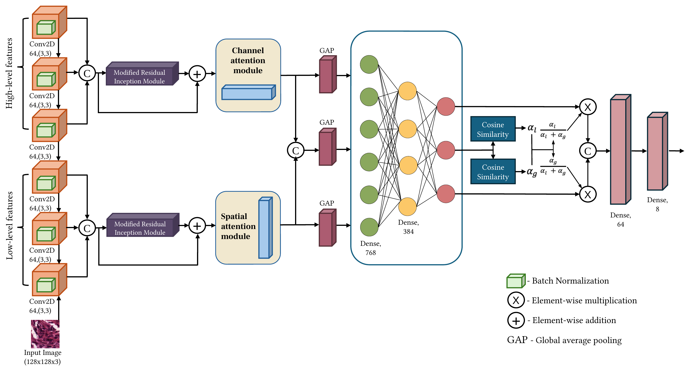

The modules drawn in the paper (dilated residual-inception block, channel attention, spatial attention):

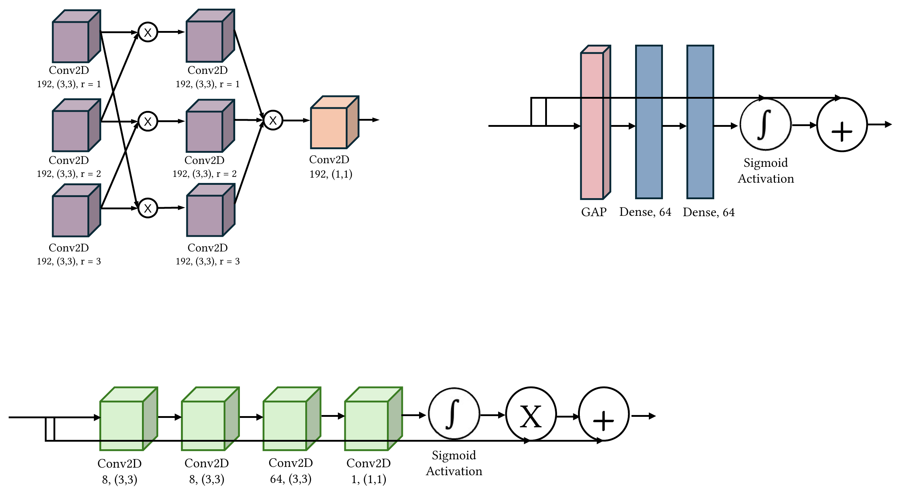

What the code in `src/fmanet/model.py` builds (this matches the notebooks' trained graph, verified by parameter count):

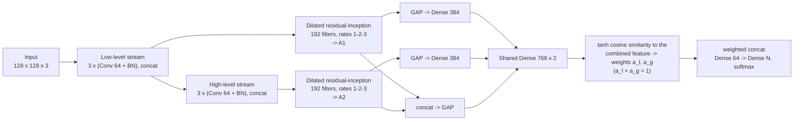

## Relationship between this code and the paper

The recorded results come from the original notebooks. Comparing them to the paper shows these differences. They are reported here so nobody mistakes the repository for an exact reproduction of every detail in the paper.

| Item | Paper | Original notebooks (and this code by default) |
|---|---|---|
| Channel and spatial attention modules | Part of the network (see figure) | Defined, but **not connected to the output**: the notebooks set `x_l = A1; x_g = A2`, so the trained graph contains neither module. A model with them wired in has 5,432,145 parameters; the notebooks' summaries show 5,389,832, which this port reproduces exactly *without* them. |
| Optimizer / learning rate / batch size | Adam, learning rate 1e-3 (the paper writes "for all 32 batches") | Nadam, learning rate 1e-4, batch size 16 |
| Second dataset | NCT-CRC-HE-100K | CRC-VAL-HE-7K (the 7,180-tile validation set) |
| Module widths in the figure | Channel attention: Dense 64, 64. Spatial attention: 3x3 convs of 8, 8, 64, then 1x1 | Channel attention: Dense C/2 then C. Spatial attention: 1x1 convs of C/16, C/16, C, then 1 |

`build_fmanet(use_attention_modules=True)` wires the two attention modules in as drawn in the paper's figure. That variant was **not trained** in the original notebooks, so no result is claimed for it.

## Dataset

| Key | Dataset | Classes | Test split |
|---|---|---|---|
| `kather-5000` | Kather et al. 2016 colorectal histology, 5,000 tiles | 8 | 10% (500 tiles) |
| `crc-val-he-7k` | CRC-VAL-HE-7K, 7,180 tiles | 9 | 10% (718 tiles) |

Datasets are not included. See [`data/README.md`](data/README.md) for download links, folder layout and citations. Images are resized to 128 x 128, scaled to [0, 1] and read with OpenCV (BGR order, as in the notebooks).

## Installation

```bash
git clone https://github.com/RashiChauhan67/FMANet.git
cd FMANet
python -m venv .venv && source .venv/bin/activate
pip install -e .
```

## Usage

```bash
# Original training protocol (the test split also drives early stopping; see below)
python scripts/train.py --data-dir /path/to/Kather_texture_2016_image_tiles_5000 \
    --dataset kather-5000 --output-dir runs/kather

# Leakage-free protocol: validation is taken from the training data, the test set is used once
python scripts/train.py --data-dir /path/to/CRC-VAL-HE-7K --dataset crc-val-he-7k \
    --protocol holdout --output-dir runs/crc_val_holdout

# Evaluate a saved model on the regenerated test split
python scripts/evaluate.py --data-dir /path/to/CRC-VAL-HE-7K --dataset crc-val-he-7k \
    --model runs/crc_val_holdout/best_model.keras
```

Defaults follow the notebooks: Nadam (1e-4), batch size 16, up to 50 epochs, early stopping on validation accuracy (patience 10, `min_delta` 0.001, best weights restored). Each run writes `best_model.keras`, `history.json` and `metrics.json`.

In Python:

```python
from fmanet.model import build_fmanet, compile_fmanet

model = compile_fmanet(build_fmanet(num_classes=8))  # 5,389,832 parameters
```

## Recorded results (from the original notebooks)

These are the numbers stored in the notebooks' outputs. **They were not re-run for this repository.**

| Dataset | Test tiles | Accuracy | Macro F1 | Epochs run | Paper reports |
|---|---|---|---|---|---|
| Kather 5,000 | 500 | **0.950** | 0.95 | 25 | 95% |
| CRC-VAL-HE-7K | 718 | **0.9735** | 0.97 | 9 | 97% (on NCT-CRC-HE-100K) |

Per-class one-vs-rest AUC (from the ROC plots): Kather 0.991 to 0.9999; CRC-VAL-HE-7K 0.9879 to 1.0000. Full per-class tables are in [`results/recorded_results.md`](results/recorded_results.md).

| Kather 5,000 | CRC-VAL-HE-7K |
|---|---|
| 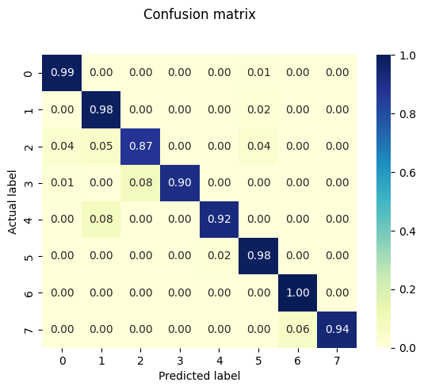 | 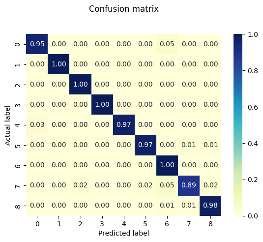 |
| 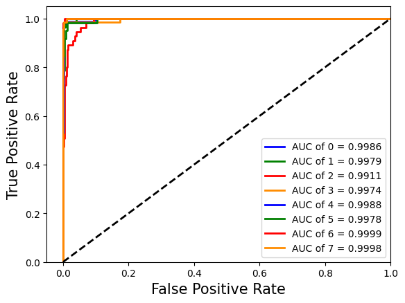 | 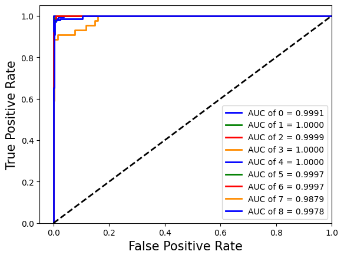 |
| 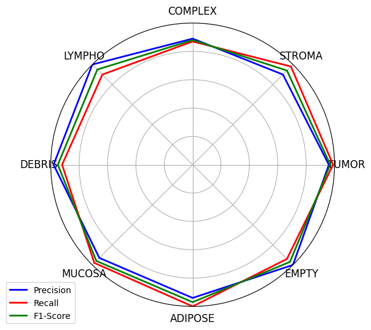 | 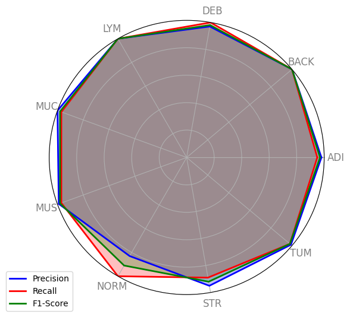 |

t-SNE of the features before and after training (Kather 5,000, then CRC-VAL-HE-7K):

| Original features | Trained features |
|---|---|
| 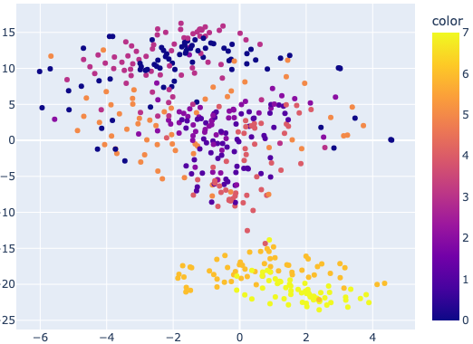 | 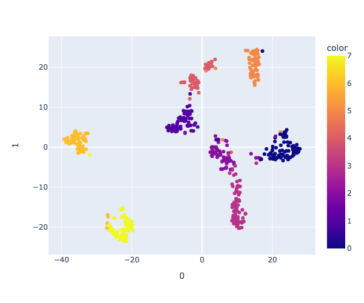 |
| 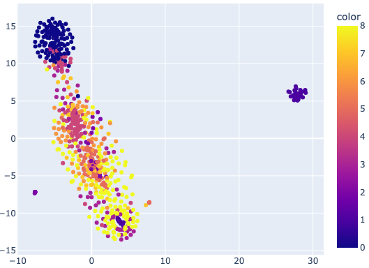 | 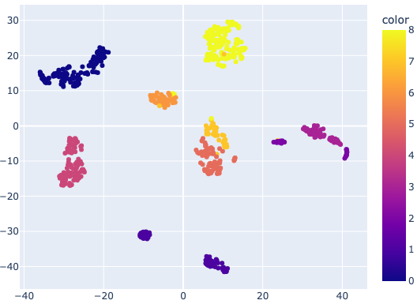 |

Class indices in the plots: Kather 0 tumor, 1 stroma, 2 complex, 3 lympho, 4 debris, 5 mucosa, 6 adipose, 7 empty. CRC-VAL-HE-7K 0 ADI, 1 BACK, 2 DEB, 3 LYM, 4 MUC, 5 MUS, 6 NORM, 7 STR, 8 TUM.

## Limitations and reproducibility notes

- **The recorded test accuracy is optimistic.** The notebooks pass the test split as `validation_data`, and early stopping and checkpoint selection monitor it. The reported test accuracy equals the best validation accuracy exactly (0.9500 and 0.9735). Use `--protocol holdout` for numbers that are not selected on the test set.
- Splits are random (not stratified), at the image level, with a fixed seed. Tiles from the same slide may appear on both sides of the split if the dataset has that structure.
- The notebooks do not set framework-level random seeds for training, so a re-run will not reproduce the recorded numbers bit for bit.
- This port reads files in sorted order; the notebooks used `os.listdir` order, so the exact test tiles can differ slightly from the original runs.
- The notebooks' FLOPs figure (about 139 GFLOPs) comes from a hand-written per-layer estimator and should be treated as approximate.
- `colorectal-tissue_dataset_1.ipynb` also contains stray radar charts from other datasets near its end; they are not part of this project.
- The second notebook originally contained an unrelated EEG experiment. Only its colorectal section (cells 0 to 51) is included here: `colorectal-tissue_dataset_2_crc_only.ipynb`.

## Repository layout

```
.
├── src/fmanet/          # model, data loading, training and evaluation
├── scripts/             # train.py, evaluate.py
├── tests/               # unit tests (synthetic data; no dataset needed)
├── notebooks/           # original notebooks (unmodified, except the EEG section removed)
├── docs/figures/        # architecture figures from the paper
├── results/             # recorded notebook results and figures
└── data/README.md       # dataset instructions
```

## Development

```bash
pip install -e ".[dev]"
ruff check .
pytest
```

The tests check, among other things, that the model has exactly the parameter counts printed by the original notebooks (5,389,832 for 8 classes, 5,389,897 for 9).

## Citation

If you use this code, please cite the paper (a `CITATION.cff` is provided):

```bibtex
@article{chauhan2025fmanet,
  author  = {Chauhan, Rashi and Karnati, Mohan and Singh, Pradeep},
  title   = {Fused multi-level attention features with a constraint fusion network for colorectal tissue classification using histopathological images},
  journal = {Computers and Electrical Engineering},
  volume  = {124},
  pages   = {110296},
  year    = {2025},
  doi     = {10.1016/j.compeleceng.2025.110296}
}
```

## License

MIT. See [LICENSE](LICENSE). The datasets have their own licenses; check them before reuse.

**Figures.** The architecture figures in `docs/figures/` are reproduced from the paper by its authors. Reuse of those figures is subject to the publisher's terms (Elsevier); the MIT license covers the code, and the result plots generated from the notebooks.
