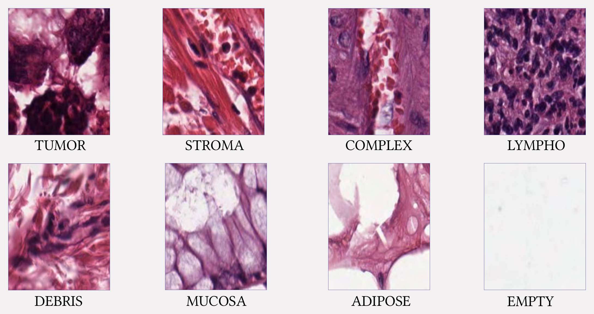
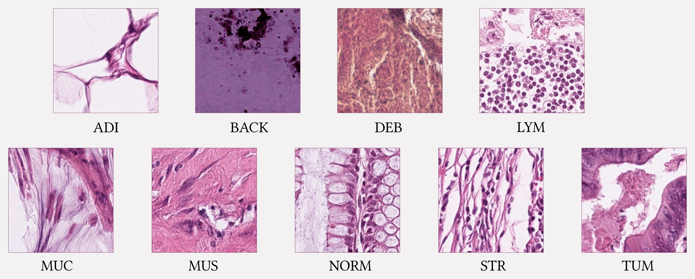

# FMANet

**Colorectal tissue classification from histopathological images, using fused multi-level attention features and constraint fusion.**

[](https://github.com/RashiChauhan67/FMANet/actions/workflows/ci.yml)
[](LICENSE)


> **Paper.** R. Chauhan, K. Mohan, P. Singh. *Fused multi-level attention features with a constraint fusion network for colorectal tissue classification using histopathological images.* **Computers and Electrical Engineering**, vol. 124, article 110296, 2025. DOI: [10.1016/j.compeleceng.2025.110296](https://doi.org/10.1016/j.compeleceng.2025.110296)
>
> **Related repository.** Code released by the paper's co-author: [KarnatiMOHAN/FMANet_colorectal-tissue_classification](https://github.com/KarnatiMOHAN/FMANet_colorectal-tissue_classification).

[Overview](#overview) · [Architecture](#architecture) · [Quick start](#quick-start) · [Datasets](#datasets) · [Results](#results) · [Notes](#notes) · [Citation](#citation)

## Overview

FMANet classifies 128 x 128 H&E tissue tiles. A **low-level** and a **high-level** feature stream, each refined by a dilated residual-inception block, are pooled and embedded by shared dense layers. **Constraint fusion** then weights each stream by its cosine similarity to the combined features, and the weighted features feed a softmax classifier.

This repository has a cleaned, tested Keras 3 implementation, the original experiment notebooks, and the recorded results.

| | Kather 5,000 | CRC-VAL-HE-7K |
|---|---|---|
| Classes | 8 | 9 |
| Test tiles | 500 | 718 |
| Test accuracy | **95.0%** | **97.35%** |
| Macro F1 | 0.95 | 0.97 |
| Parameters | 5.39 M | 5.39 M |

Accuracies are the values recorded in the notebooks.

## Architecture


## Quick start

```bash
git clone https://github.com/RashiChauhan67/FMANet.git
cd FMANet
python -m venv .venv && source .venv/bin/activate
pip install -e .
```

Train and evaluate:

```bash
# Original protocol (single train/test split)
python scripts/train.py --data-dir /path/to/Kather_texture_2016_image_tiles_5000 \
    --dataset kather-5000 --output-dir runs/kather

# Holdout protocol: validation is taken from the training data; the test set is used once
python scripts/train.py --data-dir /path/to/CRC-VAL-HE-7K --dataset crc-val-he-7k \
    --protocol holdout --output-dir runs/crc_val_holdout

# Evaluate a saved model on the regenerated test split
python scripts/evaluate.py --data-dir /path/to/CRC-VAL-HE-7K --dataset crc-val-he-7k \
    --model runs/crc_val_holdout/best_model.keras
```

Defaults: Nadam (1e-4), batch size 16, up to 50 epochs, early stopping on validation accuracy (patience 10, best weights restored). Each run writes `best_model.keras`, `history.json` and `metrics.json`.

Use the model directly:

```python
from fmanet.model import build_fmanet, compile_fmanet

model = compile_fmanet(build_fmanet(num_classes=8))  # 5,389,832 parameters
```

## Datasets

| Key | Dataset | Classes | Tiles | Test split |
|---|---|---|---|---|
| `kather-5000` | Colorectal histology (Kather et al., 2016) | 8 | 5,000 | 10% |
| `crc-val-he-7k` | CRC-VAL-HE-7K (Kather et al., 2018) | 9 | 7,180 | 10% |

Both are on Zenodo under CC BY 4.0. Data is not included; see [`data/README.md`](data/README.md) for links, folder layout and citations. Images are resized to 128 x 128, scaled to [0, 1] and read with OpenCV.





## Results

Results from the original experiment notebooks. Per-class tables are in [`results/recorded_results.md`](results/recorded_results.md).

| Dataset | Test tiles | Accuracy | Macro F1 | Epochs run | Per-class AUC |
|---|---|---|---|---|---|
| Kather 5,000 | 500 | **0.950** | 0.95 | 25 | 0.991 to 0.9999 |
| CRC-VAL-HE-7K | 718 | **0.9735** | 0.97 | 9 | 0.988 to 1.000 |

| Kather 5,000 | CRC-VAL-HE-7K |
|---|---|
|  |  |
|  |  |
|  |  |

t-SNE of the features before and after training:

| | Original features | Trained features |
|---|---|---|
| **Kather 5,000** |  |  |
| **CRC-VAL-HE-7K** |  |  |

Class indices: Kather 0 tumor, 1 stroma, 2 complex, 3 lympho, 4 debris, 5 mucosa, 6 adipose, 7 empty. CRC-VAL-HE-7K 0 ADI, 1 BACK, 2 DEB, 3 LYM, 4 MUC, 5 MUS, 6 NORM, 7 STR, 8 TUM.

## Notes

- The default model has 5,389,832 parameters for 8 classes (5,389,897 for 9), matching the notebooks' `model.summary()`; the tests check these counts.
- `build_fmanet(use_attention_modules=True)` adds the spatial- and channel-attention modules to the classification path, as shown in the architecture figure (5,432,145 parameters).
- `--protocol holdout` trains with a validation set taken from the training data and uses the test set once.

## Repository structure

```
.
├── src/fmanet/          # model, data loading, training and evaluation
├── scripts/             # train.py, evaluate.py
├── tests/               # unit tests (synthetic data; no dataset needed)
├── notebooks/           # original experiment notebooks
├── docs/figures/        # architecture and dataset figures
├── results/             # recorded notebook results and figures
└── data/README.md       # dataset instructions
```

Development: `pip install -e ".[dev]"`, then `ruff check .` and `pytest`.

## Citation

If you use this code, please cite the paper (a `CITATION.cff` is provided):

```bibtex
@article{chauhan2025fmanet,
  author  = {Chauhan, Rashi and Karnati, Mohan and Singh, Pradeep},
  title   = {Fused multi-level attention features with a constraint fusion network for colorectal tissue classification using histopathological images},
  journal = {Computers and Electrical Engineering},
  volume  = {124},
  pages   = {110296},
  year    = {2025},
  doi     = {10.1016/j.compeleceng.2025.110296}
}
```

## License

MIT. See [LICENSE](LICENSE). The datasets have their own licenses; check them before reuse.

**Figures.** The architecture figures in `docs/figures/` are reproduced from the paper by its authors. Reuse of those figures is subject to the publisher's terms (Elsevier). The dataset sample tiles come from the datasets cited in `data/README.md` (CC BY 4.0). The MIT license covers the code and the result plots generated from the notebooks.
